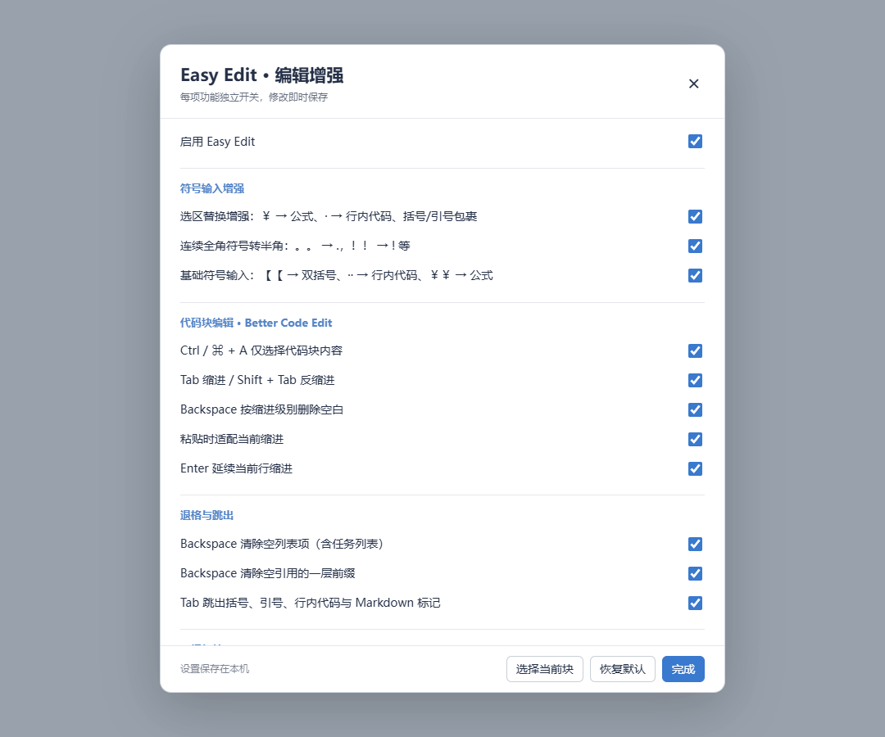

# Typora Easy Edit

[](https://github.com/Silver-Ray/typora-easy-edit/actions/workflows/ci.yml)
[下载最新版本](https://github.com/Silver-Ray/typora-easy-edit/releases/latest) · [更新记录](CHANGELOG.md)

为 Typora 实现 [Obsidian Easy Typing](https://github.com/Yaozhuwa/easy-typing-obsidian) 的 [2. Edit Enhancements](https://github.com/Yaozhuwa/easy-typing-obsidian/blob/master/Doc/EditEnhancements.md)，以及旧版的选区替换、连续全角转半角、基础符号输入三项增强。共 19 项独立开关。

独立安装，无需先安装 `obgnail/typora_plugin`。同时支持源码模式和实时预览模式；代码块使用 Typora 自带的 CodeMirror。运行时无第三方依赖。

## 安装（Windows）

1. 完全退出 Typora。
2. 解压安装包，在解压后的 `typora-easy-edit` 目录打开 PowerShell（支持 Windows PowerShell 5.1 和 PowerShell 7）。
3. 执行：

   ```powershell
   powershell -NoProfile -ExecutionPolicy Bypass -File .\install.ps1
   ```

   自定义安装位置：

   ```powershell
   powershell -NoProfile -ExecutionPolicy Bypass -File .\install.ps1 -TyporaPath 'D:\Apps\Typora'
   ```

4. 如果 Typora 安装在 `Program Files` 等受保护目录，脚本会弹出 Windows UAC 管理员权限请求，请选择“是”。完成后重启 Typora，按 **Ctrl + Alt + E** 进入设置。窗口中没有悬浮按钮。

安装脚本需要 Node.js 18+；安装好后 Typora 内的插件不依赖外部 Node.js。无需运行 `npm install`。脚本会自动寻找常见安装路径，也接受直接传入包含 `window.html` 的 `resources` 目录。

安装前自动备份 `window.html`，备份后缀为 `.easy-edit.backup`。安装器只接入渲染窗口，不修改 `app.asar`。重复安装不会重复注入，其他插件入口会保留。`-DryRun` 可以仅查看目标位置。

**v1.1.0 闪退修复：** 旧版为添加原生“帮助”菜单修改了 `app.asar`，会触发 Typora 的完整性检查并退出。请使用 **v1.1.1 或更新版本**的完整安装器重新安装；它会识别旧版改动，将 `app.asar.easy-edit.backup` 逐字节恢复为原始归档，再安装编辑功能。旧版卸载器留下的归档也可以恢复。若备份缺失或不匹配，脚本会停止，避免用其他版本覆盖当前应用；此时需要先运行官方 Typora 安装器修复应用。

原生“帮助 → 编辑增强”入口已撤下，当前通过 **Ctrl + Alt + E** 打开设置。19 项编辑功能及各自的开关保留。

也可以先以管理员身份打开终端再执行命令。`-NoElevation` 禁用自动提权，适合自动化环境；此时权限不足会返回退出码 `5`，其他安装错误返回 `1`。脚本不修改目录权限或系统执行策略。

从旧版升级时也使用同一安装命令，原有设置会保留。从 v1.1.0 升级必须运行完整安装器，仅复制渲染脚本无法修复其修改的主进程归档。

## 功能与开关

设置即时生效并自动保存到 Typora 的本机 `localStorage`。多个 Typora 窗口之间同步设置。关闭某个开关后，相应按键或粘贴事件交回 Typora 原生处理；Typora 本身具备的相似行为仍可能继续生效。



| 功能 | 行为 | 独立开关 |
| --- | --- | --- |
| Selection Replace Enhancement | 选中文字后输入符号，用对应符号包裹选区 | `selectionWrap` |
| Convert successive full width symbol | 连续输入相同全角标点，转换成半角 | `fullWidthToHalfWidth` |
| Basic symbol input enhancement | 双括号、行内代码、代码块、公式与行首符号快捷输入 | `basicSymbolInput` |
| Better Code Edit | 代码块内 Ctrl/⌘ + A 仅选择代码内容 | `codeSelectAll` |
| Better Code Edit | Tab 缩进、Shift + Tab 反缩进，支持多行选择 | `codeIndent` |
| Better Code Edit | Backspace 删除到上一个缩进停止点 | `codeBackspace` |
| Better Code Edit | 多行粘贴去掉公共缩进，再适配当前缩进 | `codePaste` |
| Better Code Edit | Enter 延续当前行缩进 | `codeEnter` |
| Better Backspace | 删除空列表项的标记，支持有序、无序、任务列表 | `emptyListBackspace` |
| Better Backspace | 退出空引用的一层引用 | `emptyQuoteBackspace` |
| Tabout | Tab 跳到最内层配对符号的右侧，再按可继续跳出外层 | `tabout` |
| Enhanced Mod+A | 依次选择当前行、当前块、整个文档 | `progressiveSelectAll` |
| Smart Paste | 多行内容粘贴到同一列表项中，并保持延续缩进 | `listPaste` |
| Smart Paste | 多行内容保持在当前引用中 | `quotePaste` |
| Strict Line Break | Enter 严格换行，提供下面三种模式 | `strictLineBreak` |
| Collapsed Heading Enter | 在折叠内容之后新建同级标题，保留原有折叠 | `collapsedHeadingEnter` |
| New Line After Current | Ctrl/⌘ + Enter 在当前行末尾换行，支持列表/引用前缀 | `newLineAfter` |
| Toggle Comment | Ctrl/⌘ + / 切换注释 | `toggleComment` |
| Select Block | 设置面板中的「选择当前块」按钮 | `selectBlock` |

另有总开关 `enabled`。以上默认开启，**严格换行默认关闭**。

### 新增的三项符号增强

选区替换：选中文字后输入 `￥` / `¥` 得到 `$文字$`，输入 `·` 得到行内代码；`【` 得到 `[文字]`；`《`、`（`、中英文引号、`「`、`『`、`<` 按对应配对符号包裹。包裹后保持内部文字被选中。

**中文标点包裹（v1.2.0）：** 选中 `文字`，输入 `“`、`”` 或输入法一次提交 `“”`，都会得到 `“文字”`；输入 `「`、`」` 或 `「」`，都会得到 `「文字」`。同样支持 `‘’`、`『』`、`（）`、`《》`、`〈〉`、`〔〕`、`〖〗`、`｛｝` 的左右两侧和整对输入。`【`/`】` 保留旧版的半角方括号包裹，整对 `【】` 使用中文方括号。文字保持选中，便于继续套上另一层符号；关闭 `selectionWrap` 后交回 Typora 原生处理。不把逗号、句号等非配对标点当成包裹符号。

连续全角转半角：`。。` → `.`、`！！` → `!`、`，，` → `,`、`？？` → `?`、`：：` → `:`、`；；` → `;`、`》》` → `>`、`｜｜` → `|`、`（（` → `()`、`《《` → `<`；全角双引号/单引号组合也可转换成英文引号，并处理已有的右括号，避免留下多余符号。

基础输入：`【【` → `[[]]`、`！【【` → `![[]]`；连续两个 `·` 生成一对反引号并把光标放在中间，空行内代码中再输入 `·` 升级为代码块；`￥￥` / `¥¥` 生成 `$光标$`，在空 `$光标$` 中输入 `￥` / `¥` / `$` 升级为块公式；行首 `、` → `/`，行首 `》` → `> `。这里只输入双括号语法，不引入 Obsidian 的双链解析功能。

三项开关互相独立。规则只处理键入和输入法提交，不转换粘贴内容；输入法组合期间不改写文字。跳过代码块、frontmatter 和块公式正文。行首 `》` 的快捷引用转换优先于后续重复输入；普通正文中的 `》》` 仍可转换为 `>`。

### Tabout 支持的符号

- 中文括号与引号：`〖〗`、`【】`、`（）`、`《》`、`〈〉`、`「」`、`『』`、`“”`、`‘’`。
- 英文括号与引号：`()`、`[]`、`{}`、`<>`、单引号、双引号。
- Markdown：反引号（含多反引号的行内代码）、`$`、`$$`、`*`、`**`、`_`、`__`、`~~`、`==`、`[[]]`。

支持嵌套及配对内容被选中的情况，忽略反斜线转义。当前没有完整配对时，Tab 继续执行原生操作。检测到常见的 CodeMirror tabstop/snippet 标记时，优先交给占位符导航。

### 严格换行

| 模式 | 正文 | 引用 | 列表 |
| --- | --- | --- | --- |
| Two Space | 两个空格 + 换行 | 两个空格 + 换行 | 原生处理 |
| Enter Twice | 双换行 | 两个带引用前缀的换行 | 原生处理 |
| Mix | 双换行 | 两个空格 + 换行 | 原生处理 |

Ctrl/⌘ + Enter 也遵守此设置。严格换行跳过代码、公式块、YAML frontmatter、标题、表格与空行；Shift + Enter 保持原生行为。实时预览中的列表、表格和公式使用 Typora 自身的结构编辑。

### 标题折叠

将光标放在标题上，按 **Ctrl/⌘ + Alt + H** 折叠或展开。在实时预览中，也可 **Alt + 点击标题**。

折叠后，在标题上按 Enter，会跳过整个折叠内容并新建同级标题。折叠只影响显示，不改 Markdown。关闭此功能或总开关会展开本插件折叠的内容；折叠状态不跨文件保存。也兼容 `obgnail/typora_plugin` 的 `collapse_paragraph` 折叠类。

### 快捷键与优先级

| 快捷键 | 功能 |
| --- | --- |
| Ctrl/⌘ + Alt + E | 打开设置，总开关关闭时也可使用 |
| Ctrl/⌘ + Alt + H | 折叠/展开当前标题 |
| Ctrl/⌘ + A | 代码块全选或逐级选择 |
| Tab / Shift + Tab | 代码缩进/反缩进；正文中 Tab 跳出配对符号 |
| Backspace | 代码缩进退格，或空列表/引用退格 |
| Ctrl/⌘ + Enter | 当前行后换行 |
| Ctrl/⌘ + / | 切换注释 |

代码块全选优先于逐级选择；代码缩进优先于 Tabout。这些开关互相独立。输入法组合期间不处理快捷键；只在编辑器内部拦截，不影响搜索框和设置输入框。

代码缩进可以跟随 Typora，或自定义为空格/Tab 及 1–8 的缩进宽度。注释命令支持常见语言的 `//`、`#`、`--`、`;`、`%`、CSS 块注释及 HTML 注释；未知代码语言交回原生处理。

## 卸载与升级

完全退出 Typora，然后在安装包目录执行：

```powershell
powershell -NoProfile -ExecutionPolicy Bypass -File .\install.ps1 -Uninstall
```

卸载移除渲染入口和本插件的自有文件，保留其他插件的入口。如检测到 v1.1.0 的主进程改动，会先精确恢复对应的原始归档。自动备份和已保存设置会保留。如需清除设置，可在 Typora 开发者工具控制台执行：

```js
localStorage.removeItem('typora-easy-edit.settings.v1')
```

Typora 更新可能重置 `window.html`，此时重新安装即可。

## 开发与验证

```powershell
npm ci
npm run check
npm test
npm run package
npm run verify:package
```

Windows 安装包生成在 `dist/typora-easy-edit-1.2.0.zip`，同时生成 `SHA256SUMS` 和 Release 元数据。`verify:package` 会解压 ZIP 并实际验证包内安装器的安装、卸载、版本及核心归档保持不变。Linux 下 `package` 生成安装目录；正式 ZIP 统一在 Windows runner 构建。

### CI/CD 与发布

推送 `main`、提交 Pull Request 或手动运行 CI 时，GitHub Actions 会在 Windows/Linux、Node.js 22/24 上执行 `npm ci`、语法检查和测试。Windows + Node.js 24 还会打包、解压验证，并保存可下载的 Actions 构建产物。CI 没有安装 Typora，涉及本机 Typora 内部模块的测试会明确跳过；源码编辑、配置、符号规则和安装器测试照常运行。

发布新版本时，同步修改 `package.json`、`package-lock.json` 和 `CHANGELOG.md`，提交后推送与版本一致的标签，例如：

```powershell
git tag v1.2.0
git push origin main v1.2.0
```

Release 工作流会重新测试标签对应的代码，复用已经校验的安装包，核对标签版本与 SHA-256，再创建带安装 ZIP、`SHA256SUMS` 和更新说明的正式 GitHub Release。也可手动运行 Release 工作流并指定已有标签。测试失败不会发布，已发布的同名版本不会被覆盖。

工作流使用固定提交 SHA 的官方 Actions。测试和构建只有读取权限，发布任务才授予 `contents: write`，使用 GitHub 自动提供的 `GITHUB_TOKEN`，无需额外配置个人令牌。

### 可选主题修复

安装包的 `theme-fixes/` 包含 Claude 浅色/深色主题的行内代码光标补丁。需要时执行 `node theme-fixes/apply.cjs`，然后切换主题再切回。脚本会备份原主题；默认安装插件不会修改主题。详见 [主题修复说明](theme-fixes/README.md)。

测试覆盖真实 CodeMirror 的编辑/选区/撤销、开关关闭后的事件回退、IME 与只读保护、配置持久化、安装卸载。若本机存在 Typora，还会读取其编辑模块，在 JSDOM 中验证实时预览的选区、Markdown 模型、列表与引用粘贴、原生撤销和标题折叠；不会修改 Typora 安装目录或用户文档。

归档回归测试比较整个 `app.asar` 的字节，验证新安装不改动归档、v1.1.0 升级和卸载恢复原始文件、拒绝不匹配的备份。编辑模块的隔离测试不覆盖 Typora 主程序自身的启动检查；实际发布还需安装到 Typora 后验证正常启动及设置面板。

默认测试路径是 `C:\Program Files\Typora\resources`，可以用 `TYPORA_RESOURCES` 环境变量覆盖。此集成测试目前适配并验证的是 **Windows Typora 1.13.4**；其他版本的内部接口、完整桌面输入法交互和其他操作系统仍需实际环境验证。测试工具不包含或分发 Typora 的代码。

文件结构：

```text
plugin/easy-edit/
  bootstrap.js    浏览器加载入口，使用 Typora 的 reqnode
  index.js        快捷键、粘贴事件及功能调度
  core.js         Markdown 文本变换与配置校验
  adapters.js     CodeMirror / 实时预览适配
  folding.js      标题折叠
  symbols.js      三组内置符号规则
  input.js        CodeMirror、beforeinput 与 IME 输入接入
  settings.js    中文设置面板与持久化
  settings.css   设置面板及折叠样式
scripts/         安装、卸载、打包
test/            单元与集成测试
```

## 参考与许可

编辑行为参考 [Edit Enhancements 文档](https://github.com/Yaozhuwa/easy-typing-obsidian/blob/master/Doc/EditEnhancements.md)；新增三项符号增强参考 [Easy Typing 5.5.15 的内置映射](https://github.com/Yaozhuwa/easy-typing-obsidian/blob/5.5.15/src/main.ts) 及当前内置规则。Typora 的 Node 加载入口和编辑接口参考 [obgnail/typora_plugin](https://github.com/obgnail/typora_plugin) 及本机 Typora 编辑模块。本项目为独立实现，MIT 许可；不包含原项目的自动排版或自定义规则引擎。
